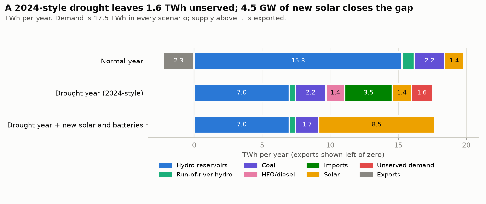
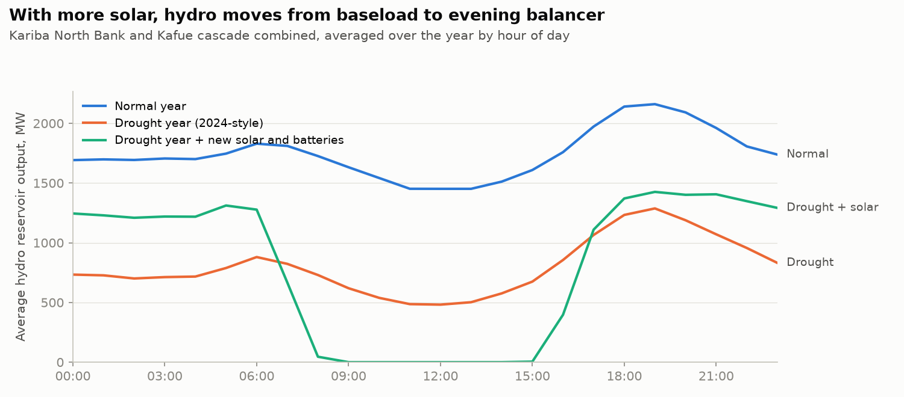
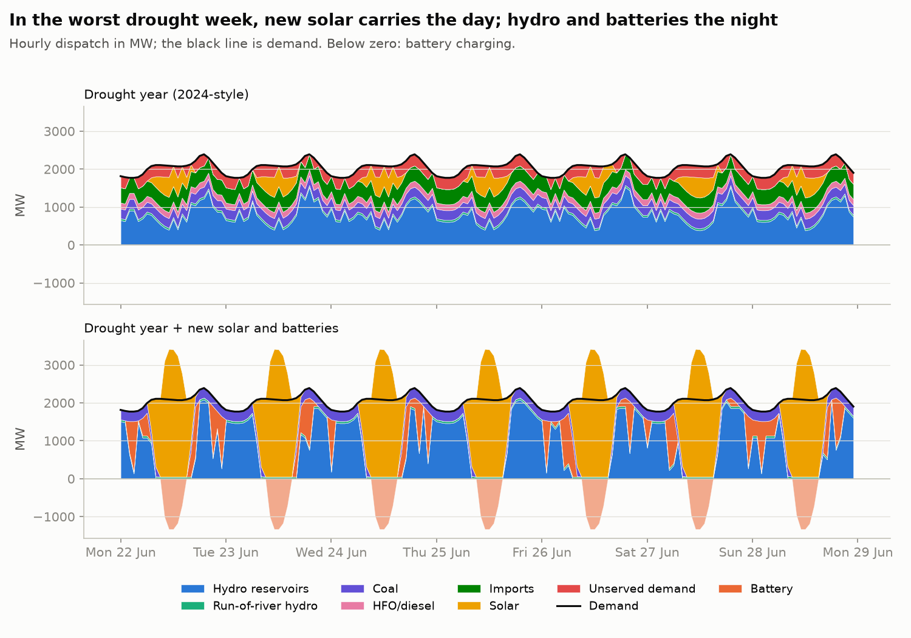

# Zambia hydro-solar model (PyPSA)

A small, open model of Zambia's power system. It asks two questions:

1. How short does supply fall if a 2024-style drought hits today's system?
2. How much solar and battery storage would close that gap, and how does hydropower's role change when it does?

The model uses only public data and runs in about three minutes on a laptop.



## Results

| | Normal year | Drought year | Drought year + new solar and batteries |
|---|---:|---:|---:|
| Hydro reservoirs (TWh) | 15.3 | 7.0 | 7.0 |
| Solar (TWh) | 1.4 | 1.4 | 8.5 |
| Coal (TWh) | 2.2 | 2.2 | 1.7 |
| HFO/diesel (TWh) | 0.0 | 1.4 | 0.0 |
| Imports (TWh) | 0.0 | 3.5 | 0.0 |
| Exports (TWh) | 2.3 | 0.0 | 0.0 |
| Unserved demand (TWh) | 0.0 | 1.6 | 0.0 |
| Hours with a shortfall | 0 | 5,269 | 0 |
| New solar built (MW) | | | 4,534 |
| New 4-hour batteries built (MW) | | | 1,329 |

- **A drought like 2024 leaves 1.6 TWh of demand unserved**, even after running HFO plants and importing at full capacity. Shortfalls of up to 300 MW occur in 60% of hours, much like rotational load shedding.
- **About 4.5 GW of new solar and 1.3 GW of four-hour batteries would close the gap** without imports or HFO. Solar then supplies about half of all electricity.
- **Hydropower changes job.** With that much solar, the reservoirs stop generating during the day and save their water for the evening peak and the night.





The expansion scenario sizes solar and storage as if every year were a drought, so treat it as a stress test, not an investment plan.

## How the model works

The whole country is one node, so the model has no transmission limits. It runs hourly for one year (8,760 hours) and finds the cheapest way to meet demand.

| Component | How it is modelled |
|---|---|
| Kariba North Bank (1,080 MW) | Storage unit with an annual water budget set by the ZRA allocation |
| Kafue cascade: Itezhi-Tezhi, Kafue Gorge Upper and Lower (1,860 MW) | One storage unit with an annual water budget |
| Victoria Falls and small hydro (146 MW) | Run-of-river generator at a fixed capacity factor |
| Solar (841 MW existing) | Generator with an hourly profile for Lusaka |
| Coal (300 MW) and HFO/diesel (186 MW) | Generators with fuel costs from PyPSA technology-data |
| Imports (400 MW) and exports (520 MW) | Generators at fixed prices |
| Unserved demand | Eight blocks of rising cost from EUR 1,000/MWh, so shortfalls spread across hours |
| New solar and batteries | Only in the expansion scenario; the optimiser chooses the size |

The water budgets give each reservoir a fixed amount of energy for the year. The optimiser decides when to use it, which is what lets hydro shift towards the evening once solar covers the day.

Scenarios:

- **Normal year:** long-term-average hydrology.
- **Drought year:** 2024 hydrology. Kariba gets ZESCO's 8 BCM allocation (about 214 MW on average), and the Kafue cascade runs at the 585 MW ZESCO reported in June 2024.
- **Drought year + new solar and batteries:** the drought year, with new solar and batteries the optimiser can build. Exports are off here, so solar is sized for Zambia's own demand.

Every assumption, with its source or the reason for it, is in [`config.yaml`](config.yaml).

## Limitations

- One node: no transmission constraints, although the grid itself is a real bottleneck in Zambia.
- Hydro is simplified to annual energy budgets. The Kafue cascade is a single unit, and there are no reservoir levels, head effects or environmental flows.
- Demand and solar profiles are stylised. Solar uses a clear-sky model with assumed monthly cloud factors, calibrated to a 19% capacity factor.
- One weather year only.
- Costs come from European technology data (Danish Energy Agency, via PyPSA technology-data) at a 10% discount rate.
- Import and export prices are fixed assumptions.
- The model is linear, so where two options cost the same it may swap between hydro and batteries from hour to hour.

## Next steps

- Replace the stylised solar profile with ERA5-based profiles from atlite.
- Model the Kafue cascade explicitly, with water flowing from Itezhi-Tezhi to Kafue Gorge Upper and Lower.
- Add monthly inflows and reservoir limits for Kariba and Itezhi-Tezhi.
- Split the country into regions with transmission lines.
- Run several hydrology years and size new capacity across wet and dry years.
- Turn the scripts into a Snakemake workflow.

## Run it

```bash
python -m venv .venv
source .venv/bin/activate        # On Windows: .venv\Scripts\activate
pip install -r requirements.txt
python run_all.py
```

`run_all.py` runs four steps in order. You can also run them one by one from the `scripts` folder:

| Step | Script | Output |
|---|---|---|
| 0 | `retrieve_costs.py` | `data/costs_2030.csv` (PyPSA technology-data v0.15.0) |
| 1 | `build_timeseries.py` | `resources/timeseries.csv`: hourly demand and solar profiles |
| 2 | `solve_network.py` | `results/networks/*.nc` and `results/summary.csv` |
| 3 | `make_figures.py` | `results/figures/*.png` |

`build_network.py` holds the network definition and is used by step 2.

## Data sources

- Ministry of Energy, [presentation at the Zim-Zam Summit, November 2025](https://energy-news-network.com/app/uploads/2025/12/Ministry-of-Energy-Zambia-Presentation.pdf): installed capacity by type, peak demand, consumption by sector.
- ZESCO, [power importation and supply update, 29 June 2024](https://www.zesco.co.zm/assets/documents/media_releases/ZESCO_POWER_IMPORTATION_AND_SUPPLY_UPDATE_OF_29_JUNE_2024.pdf): plant capacities and drought-year output.
- Zambezi River Authority, [2024 water allocation at Kariba, 28 December 2023](https://www.zambezira.org/node/2320).
- Engineering News, [8 BCM allocation equal to about 214 MW, March 2024](https://www.engineeringnews.co.za/article/zambia-zimbabwe-to-retender-5bn-batoka-hydropower-plant-2024-03-25).
- The Herald, [2024 allocation 61% below the long-term average](https://heraldonline.co.zw/?p=17256).
- Zambia Monitor, [ZESCO exports and imports in 2024](https://zambiamonitor.com/?p=44172).
- Wikipedia, [List of power stations in Zambia](https://en.wikipedia.org/wiki/List_of_power_stations_in_Zambia): Kafue Gorge Upper output in 2014, from the ERB Energy Sector Report 2014.
- Industrial Info Resources, [solar capacity of 841 MW in 2026](https://www.industrialinfo.com/iirenergy/industry-news/article/zambias-solar-expansion-builds-resilience-against-hydropower-risk--363223).
- Energy News Network, [2025 electricity consumption from ERB data](https://energy-news-network.com/?p=18559).
- University of Zambia, [measured capacity factors of Zambian solar plants](https://dspace.unza.zm/bitstreams/e709d0fa-fe94-4dbd-938a-b75af18354d4/download).
- Green Building Africa, [Bangweulu solar annual output](https://www.greenbuildingafrica.co.za/xian-energy-acquires-54mw-bangweulu-solar-pv-power-plant-in-zambia/).
- PyPSA, [technology-data v0.15.0](https://github.com/PyPSA/technology-data): cost and efficiency assumptions.

## About

Built by Jethro Mwanza as part of learning PyPSA. It uses only public data and does not represent the views of any organisation.
